# Event storm — dispute resolution (T02.2)

Text export of the board (the workbook names `eventstorm.png`; a Mermaid source is kept instead so it diffs).
Legend: 🟦 command · 🟧 domain event · 🟪 policy (whenever … then …) · 🟨 actor · 🟩 read model · 🟥 hot spot.

```mermaid
flowchart LR
  A1[🟨 Analyst] --> C1[🟦 Start resolution]
  C1 --> E1[🟧 Case snapshot taken]
  E1 --> P1{{🟪 Whenever past respond_by → expire}}
  P1 --> E0[🟧 Dispute expired]
  E1 --> E2[🟧 Reason classified]
  E2 --> C2[🟦 Gather evidence]
  C2 --> R1[🟩 Network rules + merchant policies]
  C2 --> R2[🟩 Ledger facts: 3DS / AVS / CVV / delivery / refunds]
  R1 & R2 --> E3[🟧 Evidence graded]
  E3 --> P2{{🟪 Whenever insufficient and attempts < 2 → re-plan}}
  P2 --> C2
  E3 --> E4[🟧 Abstained: insufficient evidence]
  E3 --> C3[🟦 Draft resolution]
  C3 --> E5[🟧 Draft verified / violations found]
  E5 --> P3{{🟪 Whenever violations and refine < 1 → redraft}}
  P3 --> C3
  E5 --> E6[🟧 Abstained: failed verification]
  E5 --> E7[🟧 Action prepared + idempotency key fixed]
  E7 --> P4{{🟪 Whenever REQUEST_INFO → notify, no approval}}
  P4 --> E8[🟧 Info requested]
  E7 --> P5{{🟪 Whenever < 48 h to deadline → urgent, ops_lead}}
  E7 --> E9[🟧 Approval requested]
  P5 --> E9
  E9 --> A2[🟨 Approver]
  A2 --> C4[🟦 Decide approval]
  C4 --> E10[🟧 Approved] & E11[🟧 Rejected]
  S1[🟨 Expiry sweeper] --> E12[🟧 Approval expired]
  E10 --> C5[🟦 Execute action]
  C5 --> X1[🟨 Payments: issue_refund]
  C5 --> X2[🟨 Network gateway: submit_representment]
  X1 & X2 --> E13[🟧 Side effect recorded]
  E13 --> E14[🟧 Dispute resolved]
  E14 --> E15[🟧 Notification queued]
  C5 --> E16[🟧 Execution failed → reconciliation]
  H1[🟥 Crash between tool call and apply?]:::hot -.-> E13
  H2[🟥 Two approvers click at once?]:::hot -.-> C4
  H3[🟥 Approver = requester?]:::hot -.-> C4
  classDef hot fill:#fdd,stroke:#c00
```

## Hot spots and where they are answered

| Hot spot | Answer | Spec ref |
|---|---|---|
| Crash between tool call and dispute update | Idempotency key fixed before approval; gateway dedupes on it; `side_effects` row unique per key; apply step is separate and retried | D8, M2 |
| Two approvers decide at once | Decision endpoint updates `approvals` with `WHERE status = 'pending'` in one transaction; loser gets 409 | A4 |
| Approver is the requester | Four-eyes check against `requested_by` held in state and in `approvals` | D6, A3 |
| Approval outlives the network deadline | TTL capped at `respond_by` − 24 h | D7 |
| Merchant uploads evidence while a run is awaiting approval | Snapshot is fixed at `load_case`; new evidence needs a new run after reject/expire | — |
